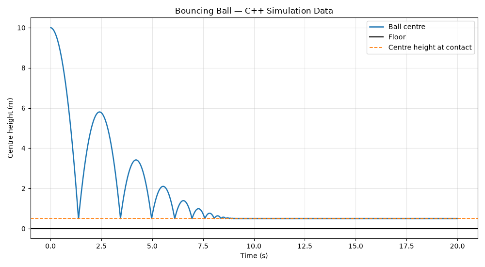
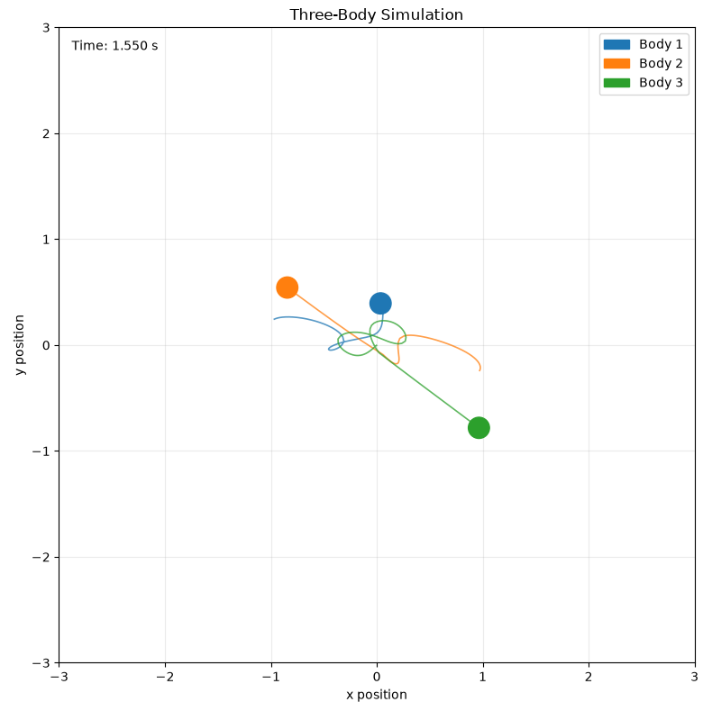
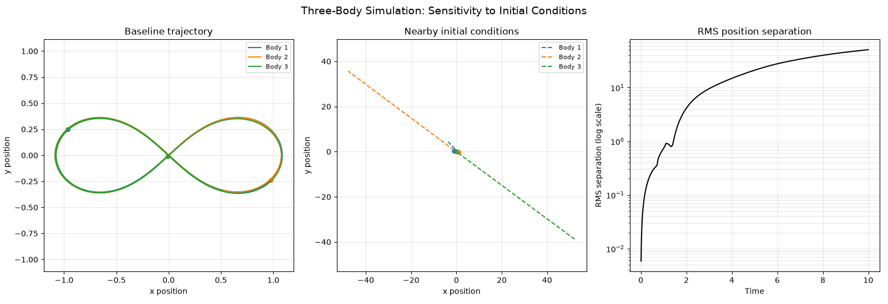

# N-body Simulations

Physics simulations written in C++, with Python (matplotlib) scripts for plotting and animation. This is built to learn the language by simulating physical systems, with the goal of a general N-body solver.

## Current

### **Bouncing ball** (`bouncing_ball/`): a ball dropped under gravity with inelastic floor collisions.

### **Three-body problem** (`3_body/`): three gravitating bodies, with initial conditions perturbed on purpose to explore chaotic behaviour.

## Planned

- Symplectic integrators
- N-body gravitational simulation
- Optimization algorithms to make it scale to larger N