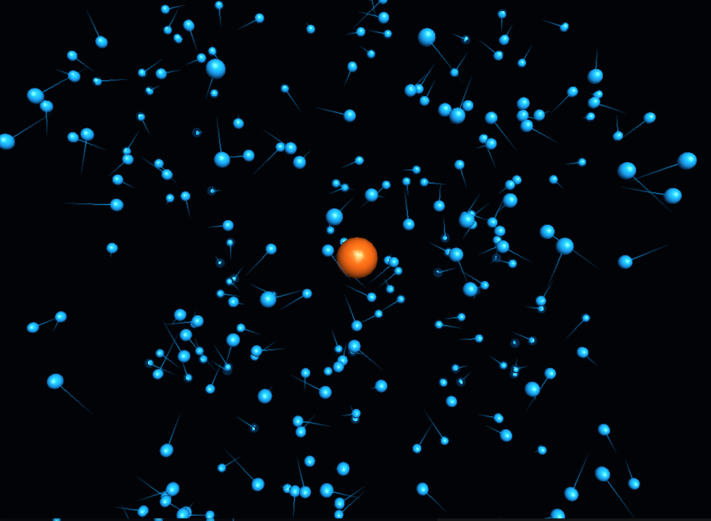
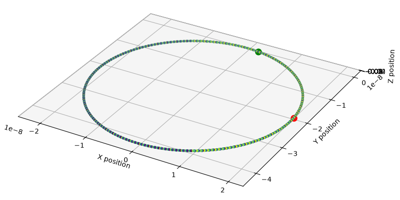

# Physics in C++

A single repository for learning C++ by implementing physics simulations from scratch. Each project is written in C++, with Python scripts for visualization.

## Projects

| Directory | Topic | Status |
|-----------|-------|--------|
| [`n-body/`](n-body/) | 3D gravitational N-body simulation | Active |
| [`accelerator/`](accelerator/) | Charged-particle motion and accelerator beam dynamics | Active |
| [`archived/`](archived/) | Earlier exercises: bouncing ball, 3-body problem | Archived |

### 3D Gravitational N-body Simulation

A 3D simulation of particles that interact through mutual gravitational attraction. The goal is a general, optimized N-body solver.



### Particle Accelerator

A particle accelerator simulator. It currently uses the Boris pusher to simulate a charged particle in a uniform magnetic field (E = 0).



## Reproduce it

Install the Python visualization dependencies from the repository root:
```
python -m pip install pygame-ce PyOpenGL PyOpenGL_accelerate pandas matplotlib
```

N-body:
```
cd n-body
g++ -std=c++17 n-body.cpp -o n-body
./n-body
python animate_n_body.py
```

Accelerator:
```
cd accelerator
g++ -std=c++23 accelerator.cpp -o accelerator
./accelerator
python plot.py path.csv
```

## Planned

N-body:
- Symplectic integrators
- Optimization algorithms to make it scale to larger N
- Exploration of the Fast Multipole Method

Accelerator:
- More complex electromagnetic fields
- Charged-particle beam dynamics and beamline simulations
