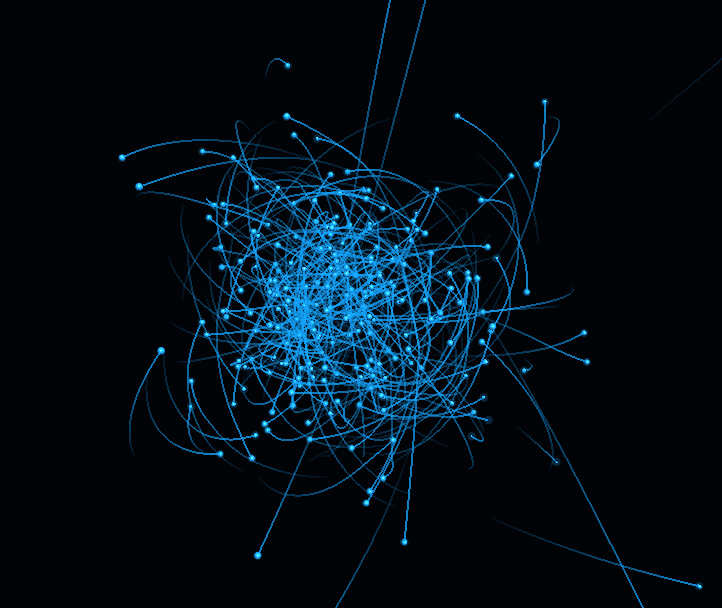

# N-body Simulations

Physics simulations written in C++, with Python scripts for visualization. This is built to learn C++ by simulating physical systems, with the goal of a general optimized N-body solver.

## Current

### 3D Gravitational N-body Simulation

A 3D simulation of particles that interact through mutual gravitational attraction.



## Reproduce it

From the root:
```
python -m pip install pygame-ce PyOpenGL PyOpenGL_accelerate
cd n-body
g++ -std=c++17 n-body.cpp -o n-body
./n-body
python animate_n_body.py
```

## Planned

- Symplectic integrators
- Optimization algorithms to make it scale to larger N
- Exploration of the Fast Multipole Method