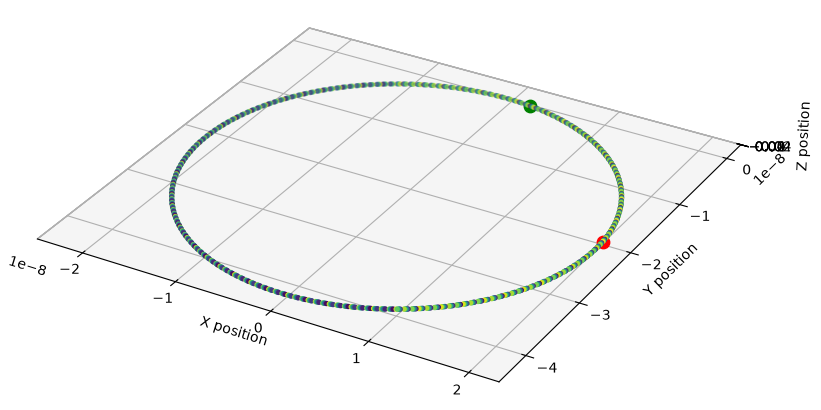

# Particle Accelerator

A particle accelerator simulator built from scratch in C++. It is part of the [Physics in C++](../README.md) learning repository.

## Current Status

### Charged-Particle Motion

Implemented the Boris pusher to simulate a charged particle in a uniform magnetic field (E = 0).



## Reproduce it

From this directory:
```
python -m pip install pandas matplotlib
g++ -std=c++23 accelerator.cpp -o accelerator
./accelerator
python plot.py path.csv
```

## Next Steps

Extend the simulation to more complex electromagnetic fields, then progress towards charged-particle beam dynamics and accelerator beamline simulations.
